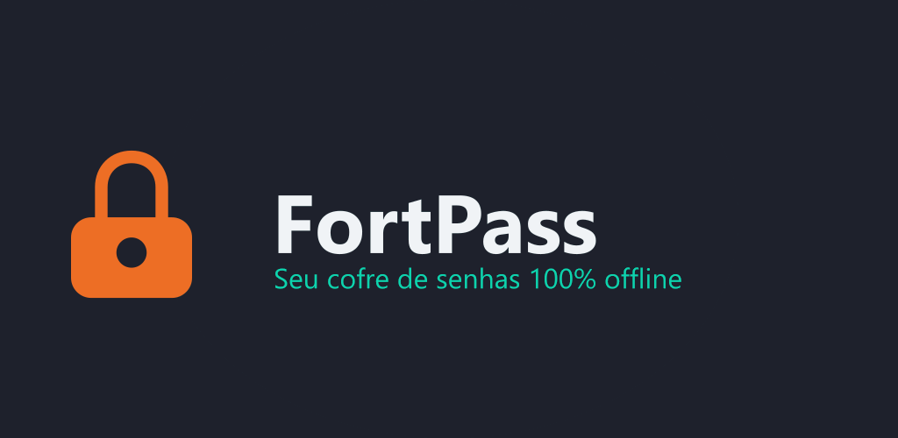
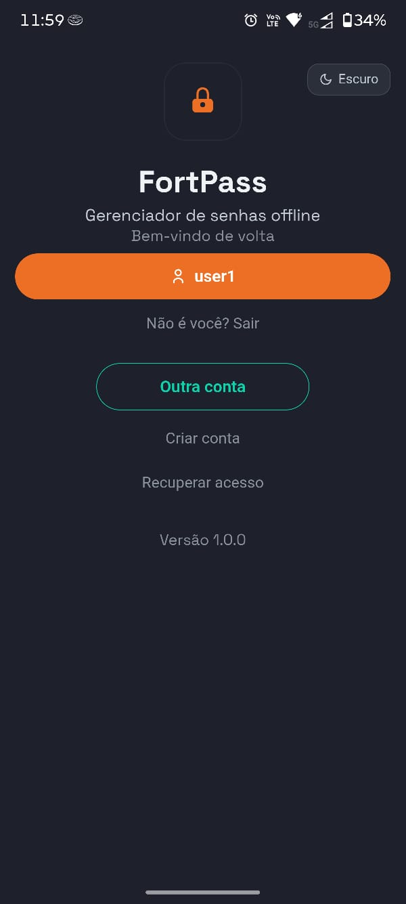
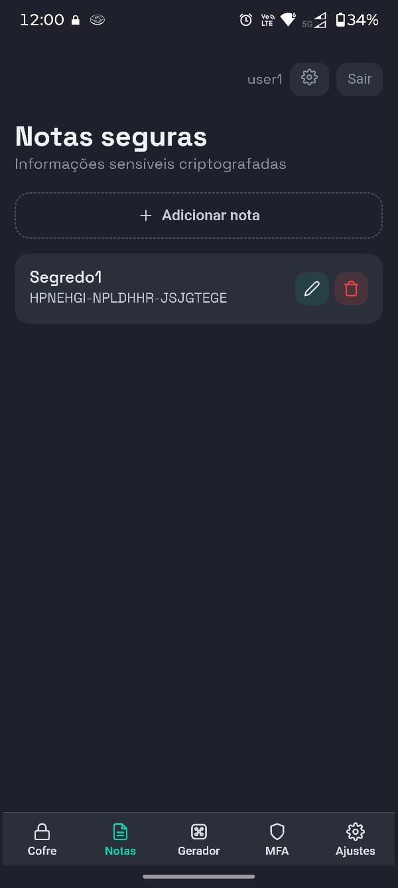
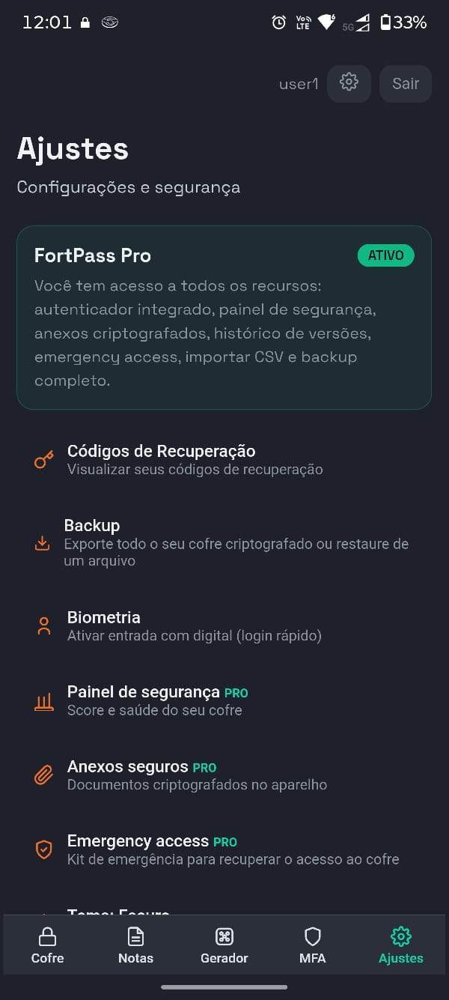

<p align="center">
  
</p>

<h1 align="center">FortiPass</h1>
<p align="center"><b>Seu cofre de senhas 100% offline</b><br>
O cofre nunca sai do dispositivo. Sem nuvem, sem conta em servidor, sem telemetria.</p>

<p align="center">
  <a href="https://play.google.com/store/apps/details?id=com.fortpass.app">
    
  </a>
  <a href="https://chromewebstore.google.com/detail/fortpass/eckgokfaekknabpbfjmlnjackkhbidpi">
    
  </a>
  <a href="https://www.fortpass.com.br">
    
  </a>
</p>

> ⚠️ **Este repositório é uma vitrine.** O código-fonte do FortiPass é **privado** (produto comercial em produção). Aqui você encontra a apresentação, funcionalidades, arquitetura em **alto nível** e screenshots.

---

## 💡 O que é

O **FortiPass** é um gerenciador de senhas **offline-first** para **Android** e **Chrome**. Ele parte de um princípio simples e radical: **o cofre nunca é transmitido** — não existe servidor de cofre, não existe conta com dados na nuvem e não há telemetria.

A única conexão de rede de todo o sistema é a **validação da assinatura pela Google Play** (para o plano Pro). Os dados do usuário permanecem, sempre, no próprio aparelho.

## ❓ Por que isso importa

Gerenciadores tradicionais dependem de nuvem. Isso os torna **alvos naturais** (o vazamento da LastPass expôs cofres cifrados de milhões) e **inviáveis** em ambientes que proíbem dados na nuvem — bancos, governo e setores regulados.

Privacidade deixou de ser recurso e virou **requisito legal** (LGPD/GDPR). Um cofre que **comprova** que os dados não saem do aparelho atende essas exigências **por arquitetura**, não por promessa.

## ✨ Funcionalidades

| | **Free** | **Pro** |
|---|:---:|:---:|
| Cofre (senhas, notas, cartões) | ✅ | ✅ |
| Gerador, autofill, biometria, backup JSON | ✅ | ✅ |
| TOTP / autenticador | — | ✅ |
| Painel de segurança (score do cofre) | — | ✅ |
| Anexos criptografados | — | ✅ |
| Histórico de versões e auto-destruição | — | ✅ |
| Emergency access (kit de recuperação) | — | ✅ |
| Importar CSV e backup completo `.fortpass` | — | ✅ |
| **Extensão do Chrome** | — | ✅ |

## 📱 Screenshots

<p align="center">
  
  
  
</p>

## 🏗️ Arquitetura (alto nível)

- **App Android** (Kotlin + WebView) — produto principal, onde o cofre reside.
- **Extensão do Chrome** (Manifest V3) — autofill no navegador (recurso Pro).
- **Site** (`fortpass.com.br`) — vitrine e Política de Privacidade em **9 idiomas**.

```
   App Android  ─┐
   Extensão      ├──▶  Cofre local (criptografado no dispositivo)
   Site          ─┘         │
                            └──▶  Google Play  (única conexão: validar assinatura)
```

## 🔐 Segurança (destaques)

- **Criptografia do cofre** com **AES-256-GCM**
- **Derivação de chave** com **Argon2id** (64 MiB)
- Chave protegida pelo **Android Keystore** (biometria com autenticação obrigatória)
- **Licença Pro assinada com Ed25519** — a extensão apenas **verifica** com a chave pública, então **não é possível forjar**
- **Sem permissão de INTERNET** para o cofre (a exceção é o billing da Play)

## 🧰 Stack

`Kotlin` · `Android` · `Chrome Extension (MV3)` · `React + Vite` (site) · `AES-256-GCM` · `Argon2id` · `Android Keystore` · `Ed25519`

## 🔗 Links

- 🛒 **Google Play:** https://play.google.com/store/apps/details?id=com.fortpass.app
- 🧩 **Chrome Web Store:** https://chromewebstore.google.com/detail/fortpass/eckgokfaekknabpbfjmlnjackkhbidpi
- 🌐 **Site:** https://www.fortpass.com.br
- 🔒 **Política de Privacidade:** https://www.fortpass.com.br/privacidade.html

---

## 📄 Licença

© 2026 **Davi Amaral**. Todos os direitos reservados.

Este repositório é uma **vitrine de apresentação**; o **código-fonte é privado**. O conteúdo aqui (texto e imagens) não pode ser reutilizado sem autorização.
